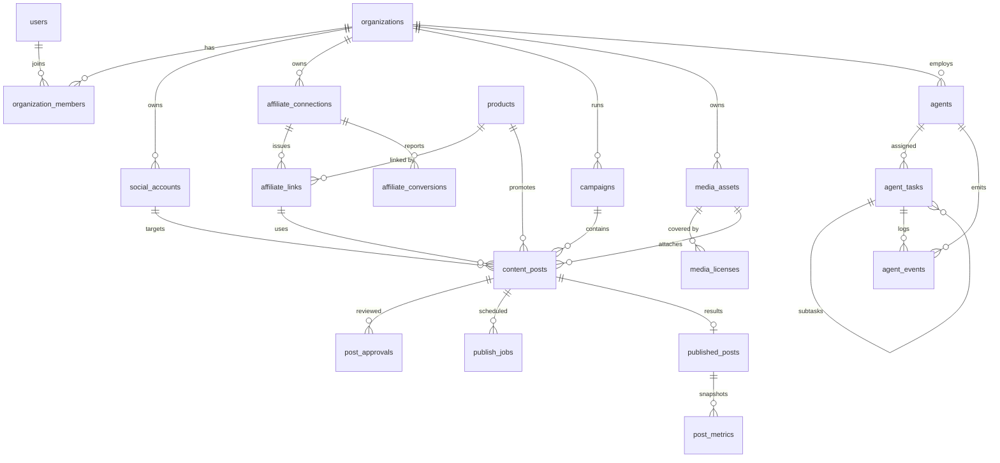

# Affiliate Content Engine — Phase 0: Thiết kế

> Trạng thái: bản nháp để duyệt. Phase 1 (khung dự án) đã được dựng kèm theo, xem `README.md`.

## 1. Hiện trạng repository

- Thư mục trống ban đầu (không có code, dependency hay quy ước sẵn có), nên không có gì bị ghi đè.
- Môi trường dựng: Node 22.22.0, npm 10.9.4.

## 2. Kiến trúc đề xuất

**Modular monolith** bằng NestJS. Một tiến trình API và một tiến trình worker (cùng codebase, bật bằng biến `APP_ROLE=api|worker|all`).

```
React admin (Phase 4+)  ──REST /api/v1──►  NestJS API ──► PostgreSQL (nguồn sự thật)
        ▲                                      │  ▲
        └────── SSE /api/v1/office/stream ─────┤  └── Redis ──► BullMQ workers
                                               │                 (đăng bài, đồng bộ, agent)
                                               └──► Adapter bên ngoài (qua interface)
                                                    Shopee · Threads · LLM · S3
```

### Nguyên tắc
1. Mọi chuyển trạng thái nội dung đi qua **một state machine duy nhất** (`ContentStateMachine`), chạy trong transaction.
2. Adapter bên ngoài nằm sau interface; luôn có bản `Mock*` gắn nhãn rõ ràng.
3. LLM chỉ **đề xuất**. LLM không đăng bài, không duyệt, không xác nhận giấy phép.
4. n8n không giữ trạng thái nghiệp vụ; hoãn đến Phase 6 và chỉ gọi API nội bộ.

### Gộp module so với prompt gốc (23 → 15)

| Module gộp | Gồm |
|---|---|
| `auth` | Auth + xác thực + refresh token |
| `organizations` | Organizations + Members + RBAC |
| `social-accounts` | SocialAccounts (+ credential vault mã hóa) |
| `affiliate` | Affiliate + ShopeeAffiliate (provider) + Products + AffiliateLinks |
| `media` | MediaAssets + MediaLicenses |
| `campaigns` | Campaigns |
| `content` | Content + Approvals + state machine |
| `content-generation` | AI provider + prompt + validate JSON |
| `publishing` | Scheduler + Publisher + ThreadsPublisher |
| `analytics` | Metrics + conversions |
| `workflows` | Hook n8n (Phase 6) |
| `notifications` | Thông báo |
| `audit-logs` | Audit |
| `health` | Health/readiness |
| **`agents`** (mới) | Văn phòng AI: agent, task, event, SSE |

`SharedModule` thành thư mục `common/` (không phải module Nest).

## 3. Văn phòng AI (lớp "công ty")

### Ý tưởng
Mỗi **agent** là một "phòng ban" gắn với một năng lực có sẵn. Agent không phải thực thể tự do: nó là vỏ bọc quanh một service/processor và báo trạng thái ra giao diện.

| Agent (key) | Phòng ban | Thực thi bằng | LLM? |
|---|---|---|---|
| `director` | Giám đốc (điều phối) | Service điều phối | Không (giai đoạn đầu) |
| `research` | Nghiên cứu | WF-01 đồng bộ + chấm điểm sản phẩm | Tùy chọn |
| `writer` | Viết bài | WF-03 | **Có** |
| `designer` | Thiết kế | WF-02 chọn media có giấy phép | Không |
| `qa` | QA·QC | Rule check (giấy phép, claim, disclosure, trùng lặp) | Tùy chọn (nhận xét) |
| `publisher` | Đăng bài | WF-05 BullMQ | **Không** |
| `analyst` | Đo số liệu | WF-06 | Không |
| `community` | Trả lời comment | Soạn nháp | **Có**, người duyệt |

### Mô hình dữ liệu
- `agents`: danh sách agent của mỗi tổ chức, trạng thái hiện tại (`IDLE | WORKING | WAITING_APPROVAL | ERROR | PAUSED`), vị trí trên bản đồ (`map_x`, `map_y`).
- `agent_tasks`: một đơn vị công việc, có `parent_task_id`, `assigned_agent_id`, `status`, tham chiếu thực thể (`entity_type`, `entity_id`).
- `agent_events`: nhật ký bất biến cho giao diện, ví dụ `TASK_STARTED`, `HANDOFF` (từ agent A sang B), `NEEDS_APPROVAL`, `TASK_FAILED`.

### Realtime
`GET /api/v1/office/stream` (Server-Sent Events) đẩy `agent_events` mới. Bước đầu dùng `EventEmitter` trong tiến trình; khi có nhiều worker thì chuyển sang Redis pub/sub (đã có Redis).

### Giới hạn an toàn
- Agent **không có quyền** chuyển trạng thái `APPROVED`, `SCHEDULED`, `PUBLISHED`. Chỉ người (reviewer) và `publisher` (code) làm được, qua state machine.
- Chế độ "Dừng tự chạy" (`PAUSED`) tắt toàn bộ tác vụ tự động của tổ chức.

## 4. ERD



### Ràng buộc quan trọng
- `organization_members`: UNIQUE `(organization_id, user_id)`.
- `products`: UNIQUE `(provider, external_product_id)`. Giá/hoa hồng NULL nghĩa là "chưa biết", khác 0.
- `publish_jobs`: UNIQUE `idempotency_key`.
- `published_posts`: UNIQUE `(social_account_id, external_post_id)`.
- `affiliate_conversions`: UNIQUE `(affiliate_connection_id, external_order_id, external_product_id)`.
- `post_approvals`: gắn với `(content_post_id, content_version)`; bài chỉ đăng được khi bản duyệt gần nhất = `content_version` hiện tại.
- `agents`: UNIQUE `(organization_id, key)`.

### Kế hoạch migration
| # | Nội dung | Phase |
|---|---|---|
| 001 | organizations, users, organization_members, agents, agent_tasks, agent_events (**đã có**) | 1 |
| 002 | social_accounts, affiliate_connections, products, affiliate_links | 2–3 |
| 003 | media_assets, media_licenses | 3 |
| 004 | campaigns, content_posts, post_approvals | 4 |
| 005 | publish_jobs, published_posts | 5 |
| 006 | post_metrics, affiliate_conversions, audit_logs | 6 |

Không dùng `synchronize: true`.

## 5. Quyền API bên ngoài và giả định chưa xác minh

| Hạng mục | Tình trạng | Việc cần làm |
|---|---|---|
| **Threads API** | Có API chính thức. Giới hạn 250 bài/24h/profile, văn bản tối đa 500 ký tự (theo tài liệu Meta). | Tạo Meta app, thêm `threads_basic` + `threads_content_publish`. Xác minh yêu cầu App Review, thời hạn token, quyền insights trước Phase 5. |
| **Shopee Affiliate Open API** | Có API (GraphQL, ký HMAC-SHA256): offer, short link, báo cáo conversion. | Đăng ký tài khoản affiliate và xin App ID/Secret. **Chưa xác minh** endpoint và điều kiện cho Việt Nam. Dùng mock + import CSV trong lúc chờ. |
| **LLM provider** | Cần API key. | Chọn nhà cung cấp, đặt `LLM_PROVIDER` (mặc định `mock`). |
| **Object storage** | Dev dùng MinIO (S3-compatible). | Production chọn S3/R2/…. |
| **Media có giấy phép** | Cần đối tác cấp phép thật. | Bắt đầu bằng bài chữ/ảnh nếu chưa có nguồn video hợp lệ. |

Giả định cần bạn xác nhận:
1. Một tổ chức có nhiều tài khoản Threads, mỗi tài khoản tự OAuth.
2. Tách quyền duyệt/soạn (separation of duties) là tùy chọn theo tổ chức.
3. Mỗi bài dùng một `subId` riêng cho short link để đối soát. Cần xác minh với API Việt Nam.

## 6. Cấu trúc thư mục

```
affiliate-content-engine/
├─ docker-compose.yml
├─ .env.example
├─ docs/PHASE0.md
├─ backend/
│  ├─ package.json, tsconfig*.json, nest-cli.json
│  └─ src/
│     ├─ main.ts, app.module.ts
│     ├─ config/env.validation.ts
│     ├─ common/
│     ├─ database/ (data-source.ts, migrations/)
│     └─ modules/
│        ├─ health/
│        ├─ agents/        ← văn phòng AI (Phase 1: khung)
│        ├─ content/       ← state machine (Phase 1) + duyệt (Phase 4)
│        └─ … (các module sau)
└─ frontend/ (Phase 4)
```

## 7. Checklist Phase 1

- [x] Cấu trúc dự án NestJS, TypeScript strict
- [x] Validate biến môi trường
- [x] TypeORM + PostgreSQL (không synchronize) + migration 001
- [x] Redis + BullMQ (kết nối, queue mẫu)
- [x] Swagger tại `/api/docs`, route `/api/v1`
- [x] Health `/api/v1/health` và `/api/v1/health/ready`
- [x] Docker Compose: PostgreSQL, Redis, MinIO
- [x] Khung văn phòng AI: entity, service phát event, SSE, seed 8 agent
- [x] State machine nội dung + unit test mọi chuyển trạng thái
- [ ] ESLint (làm cùng Phase 2)
- [ ] Integration test với PostgreSQL/Redis thật (cần Docker; chưa chạy được trong môi trường dựng)

## 8. Rủi ro đã biết
- Meta App Review và duyệt Shopee có thể chậm; không nằm trong tầm kiểm soát của code.
- Đăng tự động nhiều tài khoản có thể bị coi là spam; giữ tần suất thấp và có bước duyệt người.
- Trả lời comment tự động: chỉ soạn nháp, người duyệt.
